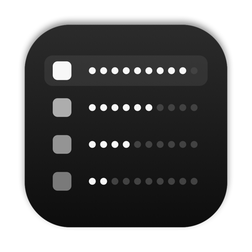

  

  
  

<h1 align="center">Instances</h1>

See every running app and what it costs in CPU, GPU and memory, then quit it in a click.

  

## Install

Needs an Apple Silicon Mac on macOS 13+ with the Xcode command line tools
(`xcode-select --install`).

1. Download and unzip this repo.
2. In the folder, run `./build.sh`. It installs Instances to `~/Applications` and opens it.

## Use

- **Open Instances** (or click the system pill if you use SketchyBar) to drop
  the panel down. Open it again to close it.
- **Apps** lists every app with its helpers counted in. **Processes** lists every PID.
- **Hover a row and click ✕** to quit it. Hold **⌥** to force quit.
- Click **CPU**, **GPU** or **MEM** to sort. Type to filter. **Esc** closes.

---

⭐ If Instances found what's eating your Mac, <a href="https://github.com/Christianships/Instances">star the repo</a>.

