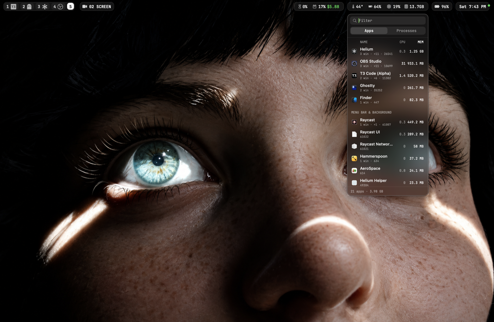

# Instances

A small macOS panel that lists every running app and process, with what each one is costing in CPU, GPU and memory, and lets you quit or kill them. It drops down from the temp · GPU · CPU · MEM pill in [SketchyBar](https://github.com/FelixKratz/SketchyBar) and replaces opening `btop` in a terminal.



## What it does

**Apps tab.** Every running app, with its helpers and child processes counted in. A browser's renderers, a terminal's shells and an Electron app's helpers all go into its row, so the CPU, GPU and MEM numbers are what the app really costs. Each row shows:

- window count (`3 win`), helper count (`+11`) and PID
- instance numbers when an app runs more than once, e.g. two Ghostty windows as separate processes
- regular apps on top, then a **Menu bar & background** section for agents like Raycast, Hammerspoon and AeroSpace

macOS's own UI agents in `/System/Library/CoreServices` (Dock, Control Center and so on) stay out of this tab, since quitting them breaks the session or they come straight back. Finder is the exception.

**Processes tab.** Every PID from libproc, your own by default. Turn on **All users** to see everyone's. `launchd`, `kernel_task`, `WindowServer` and `loginwindow` can't be killed from here, because killing them ends your session.

**Controls**

| Action | Result |
| --- | --- |
| Type in **Filter** | Filter by name or PID |
| `⌘1` / `⌘2` | Switch between Apps and Processes |
| Click NAME / CPU / GPU / MEM | Sort by that column (MEM by default). Click **GPU** to see what's using the graphics chip most |
| Click an app row | Bring the app forward and close the panel |
| Hover a row, click **✕** | Quit the app, or send `SIGTERM` to the process |
| Hold **⌥** and click **✕** | Force quit, or send `SIGKILL` |
| Right-click | Show / Hide, Reveal in Finder, Copy PID, Quit All N Instances |
| `Esc` or click away | Close the panel |

The numbers refresh every 2 seconds while the panel is open, and sampling stops when it closes. The footer shows totals (`21 apps · 3.98 GB`).

## How it works with SketchyBar

1. The `temp`, `gpu`, `cpu` and `mem` items in `~/.config/sketchybar/items/system.sh` share a bracket named `system`, and all of them run `plugins/open_monitor.sh` when clicked.
2. `open_monitor.sh` runs `open -a ~/Applications/Instances.app`. If the app isn't installed, it falls back to opening `btop` in Ghostty on the nearest empty AeroSpace workspace.
3. The first click launches Instances. It's an `LSUIElement` app, so there's no Dock icon or menu bar. Later clicks arrive as a "reopen" (`applicationShouldHandleReopen`), which toggles the panel open or shut.
4. To position itself, the panel runs `sketchybar --query system`, reads the bracket's `bounding_rects` and sits 6 pt below the pill at the same width. The pill's labels change width every second, so the panel checks again once a second while it's open. If SketchyBar can't be queried, the panel opens under the mouse at 260 pt wide.

## How it works inside

| File | What it does |
| --- | --- |
| `Sources/main.swift` | App delegate, borderless floating `NSPanel` with a HUD blur, placement under the pill, toggle on reopen, hide when it loses focus |
| `Sources/Sampler.swift` | Lists every PID with `proc_listallpids`, reads name/parent/owner with `proc_pidinfo` and CPU time plus physical footprint with `proc_pid_rusage`. Gets CPU % by comparing two samples. Reads per-process GPU time from the `IOAccelerator` user clients in the IORegistry. Counts windows with `CGWindowListCopyWindowInfo` |
| `Sources/Store.swift` | Links `NSRunningApplication`s to their child processes, numbers duplicate instances and handles quit/kill |
| `Sources/Views.swift` | SwiftUI UI: filter, tabs, sortable columns, rows, context menus |

Memory is the physical footprint, the same figure as Activity Monitor's Memory column. CPU is a percent of one core, so it can go over 100. GPU is the share of GPU time since the last sample, 0–100, and needs no root, unlike `powermetrics`. WindowServer draws the whole screen, so it usually tops the GPU list in the Processes tab. No permissions are needed: window counts only use owner PIDs and bounds, not titles, so Screen Recording isn't required.

## Build

Requires Xcode command line tools and an Apple Silicon Mac on macOS 13 or later.

```sh
./build.sh           # compile, ad-hoc sign, install to ~/Applications, open the panel
./build.sh --no-run  # build and install only
```

The build runs `swiftc` directly, with no Xcode project. It stops any running copy before it replaces the installed app.
